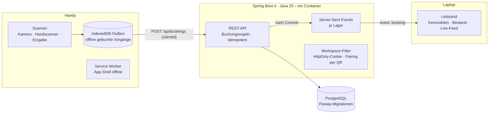

# Lager-Scan – das Handy als Barcode-Scanner fürs Lager

**Live-Demo: https://angular.umut-aslan.dev** · kein Login nötig, jeder Besucher bekommt ein eigenes Demo-Lager

Im Ersatzteillager vieler Maschinenbauer steht ein „PC auf Rollwagen“: Teil suchen, zum Rechner schieben, Menge abtippen.
Lager-Scan ersetzt das durch das Smartphone. Etikett scannen (Kamera oder Bluetooth-Handscanner), Aktion wählen, buchen –
auch ohne WLAN in der hintersten Regalreihe. Der Leitstand am Laptop zeigt jede Buchung sofort an.

> Demo mit frei erfundenen Artikeln: ein Ersatzteillager mit 36 Artikeln, 32 Lagerplätzen und drei Tagen Buchungshistorie.

## So probiert man es aus
1. https://angular.umut-aslan.dev am Laptop öffnen – das ist der **Leitstand**.
2. Den QR-Code mit der Handykamera scannen. Das Handy öffnet den **Scanner** im selben Lager.
3. Unter **Etiketten** (am Laptop-Bildschirm oder ausgedruckt) einen Lagerplatz oder Artikel scannen und buchen:
   Wareneingang, Entnahme, Umlagerung, Inventur oder Foto. Die Buchung erscheint sofort am Leitstand.
4. Flugmodus an, weiter buchen, Flugmodus aus: die Buchungen werden nachgesendet.

## Architektur



| Schicht | Aufgabe | Technik |
|---|---|---|
| **Frontend** | Scanner fürs Handy, Leitstand fürs Büro, Etiketten zum Drucken; offline-fähig | Angular 22 (standalone, Signals, zoneless), Service Worker, IndexedDB, jsQR / BarcodeDetector |
| **Backend** | Buchungsregeln (kein negativer Bestand, Inventurdifferenz), idempotente Buchungen, Fotos, Live-Events | Spring Boot 4.1, Java 25 (virtuelle Threads), Spring Data JPA / Hibernate 7 |
| **Daten** | ein Lager je Besucher, Kopie einer Vorlage; Bestand mit Zeilensperre bei gleichzeitigen Buchungen | PostgreSQL 17, Flyway |

Entscheidungen und Begründungen: [docs/adr](docs/adr).

## Was die Tests absichern

| Ebene | Anzahl | Beispiele |
|---|---|---|
| Domäne (JUnit) | 3 | Entnahme über Bestand wird abgelehnt – mit verständlicher Meldung · Inventur liefert die Differenz |
| API + PostgreSQL (JUnit, echter Server auf Zufallsport) | 9 | Scan erkennt Artikel, EAN und Lagerplatz · doppelt gesendete Buchung wird nur einmal gebucht · Pairing per Link · Live-Event kommt beim Leitstand an · Fotos · Sicherheits-Header |
| Frontend (Vitest) | 12 | Outbox: offline speichern, später in Buchungsreihenfolge senden, nie doppelt · Offline-Katalog · gescanntes Lagerplatz-Etikett füllt das Formular |
| End-to-End (Playwright) | 11 | Handy per QR verbinden, umlagern, Leitstand zeigt es live · offline buchen und nachsenden · Kamera-Scan (künstliche Kamera mit QR-Video) · Scanner öffnet ohne Netz · kein Querscrollen auf 360 px |

## Lokal starten

Voraussetzung: nur Docker.

```bash
cp .env.example .env     # Datenbank-Passwort setzen
./ops.sh test            # alle Tests, isoliert vom Live-System
./ops.sh deploy          # Tests, dann Start hinter Traefik
```

`./mvn.sh` und `./node.sh` führen Maven bzw. npm im Container aus (z. B. `./node.sh npx ng test`).

---
Ein Projekt von [Umut Aslan](https://umut-aslan.dev) · [Wie KI bei diesem Projekt eingesetzt wurde](docs/AI-WORKFLOW.md)
